# HireNexa Enterprise 2.0 — Complete Database Entity-Relationship Diagram (ERD)

This document provides the authoritative structural data model and entity-relationship architecture for the HireNexa Enterprise Platform, spanning IAM, Organizations, India Location Hierarchy, Candidate Portfolios, Resumes, Jobs, Applications, Assessments, and AI Intelligence.

---

## 1. Unified Entity-Relationship Diagram (Mermaid)

```mermaid
erDiagram
    %% ==========================================
    %% IDENTITY & ACCESS MANAGEMENT
    %% ==========================================
    USER {
        int id PK
        string username UK
        string email UK
        string password
        string role "OWNER|COMPANY_ADMIN|RECRUITER|CANDIDATE|FREELANCER"
        boolean is_active
        boolean is_staff
        boolean is_superuser
        datetime created_at
    }

    AUDIT_LOG {
        int id PK
        int user_id FK
        string action
        string entity_type
        int entity_id
        json details
        string ip_address
        datetime timestamp
    }

    OTP_VERIFICATION {
        int id PK
        string email
        string phone
        string otp_code
        datetime expires_at
        boolean is_verified
        int attempts_count
    }

    USER ||--o{ AUDIT_LOG : "generates"
    USER ||--o{ OTP_VERIFICATION : "requests"

    %% ==========================================
    %% ORGANIZATIONS & MULTI-TENANCY
    %% ==========================================
    ORGANIZATION {
        int id PK
        string name UK
        string slug UK
        string industry
        string company_size
        string verification_status "APPROVED|PENDING|REJECTED"
        string building_name
        string unit_number
        string street_address
        string registered_office_address
        string branch_office_address
        string map_url
        string directions_url
        string area
        string city
        string district
        string state
        string pin_code
        string formatted_address
        int state_ref_id FK
        int district_ref_id FK
        int city_ref_id FK
        int area_ref_id FK
        int pincode_ref_id FK
        decimal latitude
        decimal longitude
        boolean is_active
        datetime created_at
    }

    ORGANIZATION_MEMBER {
        int id PK
        int organization_id FK
        int user_id FK
        string role "ADMIN|HR|INTERVIEWER"
        boolean is_active
        datetime joined_at
    }

    SUBSCRIPTION_PLAN {
        int id PK
        string name UK
        string tier "FREE|GROWTH|PRO|ENTERPRISE"
        decimal price_monthly
        int max_active_jobs
        int max_hr_seats
        int ai_credits_monthly
        boolean is_active
    }

    PAYMENT {
        int id PK
        int organization_id FK
        int plan_id FK
        decimal amount
        string currency
        string transaction_id UK
        string status "SUCCESS|PENDING|FAILED"
        datetime verified_at
        datetime created_at
    }

    ORGANIZATION ||--o{ ORGANIZATION_MEMBER : "employs"
    USER ||--o{ ORGANIZATION_MEMBER : "belongs_to"
    ORGANIZATION ||--o{ PAYMENT : "subscribes_through"
    SUBSCRIPTION_PLAN ||--o{ PAYMENT : "billed_by"

    %% ==========================================
    %% INDIA LOCATION HIERARCHY
    %% ==========================================
    COUNTRY {
        int id PK
        string name UK
        string iso2 UK
        string phone_code
    }

    STATE {
        int id PK
        int country_id FK
        string name
        string code
        string type "state|union_territory"
    }

    DISTRICT {
        int id PK
        int state_id FK
        string name
        string headquarters
    }

    CITY {
        int id PK
        int state_id FK
        int district_id FK
        string name
        boolean is_metro
        int tier
    }

    AREA {
        int id PK
        int city_id FK
        string name
    }

    PIN_CODE {
        int id PK
        string pin_code
        int state_id FK
        int district_id FK
        int city_id FK
        int area_id FK
        string office_name
    }

    COUNTRY ||--o{ STATE : "contains"
    STATE ||--o{ DISTRICT : "contains"
    STATE ||--o{ CITY : "contains"
    DISTRICT ||--o{ CITY : "governs"
    CITY ||--o{ AREA : "contains"
    AREA ||--o{ PIN_CODE : "served_by"

    ORGANIZATION }o--|| STATE : "state_ref"
    ORGANIZATION }o--|| DISTRICT : "district_ref"
    ORGANIZATION }o--|| CITY : "city_ref"
    ORGANIZATION }o--|| AREA : "area_ref"
    ORGANIZATION }o--|| PIN_CODE : "pincode_ref"

    %% ==========================================
    %% CANDIDATE PROFILES & PORTFOLIO
    %% ==========================================
    CANDIDATE_PROFILE {
        int id PK
        int user_id FK
        string full_name
        string headline
        string education
        string university
        int graduation_year
        string cgpa
        string location
        string preferred_work_mode
        string skills
        string github_url
        string linkedin_url
        boolean resume_consent
    }

    CANDIDATE_SKILL {
        int id PK
        int candidate_id FK
        string name
        string proficiency
        float years_of_experience
        boolean verified
    }

    PROJECT_PORTFOLIO {
        int id PK
        int candidate_id FK
        string project_name
        string category
        string technologies
        string github_url
        string live_demo_url
        datetime created_at
    }

    PROJECT_FILE {
        int id PK
        int project_id FK
        int candidate_id FK
        string file_name
        string file_path
        string file_type
        bigint file_size
        datetime uploaded_at
    }

    USER ||--|| CANDIDATE_PROFILE : "has_profile"
    USER ||--o{ CANDIDATE_SKILL : "owns_skills"
    USER ||--o{ PROJECT_PORTFOLIO : "builds"
    PROJECT_PORTFOLIO ||--o{ PROJECT_FILE : "attaches"

    %% ==========================================
    %% RESUMES & ATS INTELLIGENCE
    %% ==========================================
    RESUME {
        int id PK
        int candidate_id FK
        string file
        string file_name
        int file_size
        string file_hash
        string mime_type
        text extracted_text
        boolean is_verified
        datetime uploaded_at
    }

    RESUME_EXTRACTED_DATA {
        int id PK
        int resume_id FK
        json skills
        json education
        json experience
        text summary
        datetime extracted_at
    }

    USER ||--o{ RESUME : "uploads"
    RESUME ||--|| RESUME_EXTRACTED_DATA : "parsed_into"

    %% ==========================================
    %% JOBS, APPLICATIONS & WORKFLOW
    %% ==========================================
    JOB {
        int id PK
        int organization_id FK
        int recruiter_id FK
        string title
        string company_name
        string target_course
        int vacancies
        string hiring_rounds
        string job_type
        string workplace_type
        string location
        string city
        string state
        decimal salary_min
        decimal salary_max
        string required_skills
        int min_experience_years
        string status "ACTIVE|PAUSED|FILLED|CLOSED"
        boolean is_active
        datetime created_at
    }

    APPLICATION {
        int id PK
        int candidate_id FK
        int job_id FK
        int resume_id FK
        string status "APPLIED|SCREENING|ROUND_1|ROUND_2|ROUND_3|FINAL_ROUND|SHORTLISTED|INTERVIEW|OFFER|HIRED|REJECTED"
        float skill_score
        float final_score
        int recruiter_rating
        text recruiter_notes
        text rejection_reason
        datetime created_at
    }

    AI_MATCH_RESULT {
        int id PK
        int application_id FK
        float overall_score
        float skill_score
        float semantic_score
        json matched_skills
        json missing_skills
        text explanation
    }

    INTERVIEW {
        int id PK
        int application_id FK
        string round_name
        datetime scheduled_at
        string mode "ONLINE|IN_PERSON|PHONE"
        string provider "INTERNAL|ZOOM|GOOGLE_MEET|IN_PERSON|PHONE"
        string meeting_id
        string meeting_password
        int duration_minutes
        string meeting_link
        json meeting_metadata
        string status "SCHEDULED|COMPLETED|CANCELLED"
    }

    ORGANIZATION ||--o{ JOB : "posts"
    USER ||--o{ JOB : "recruiter_posts"
    JOB ||--o{ APPLICATION : "receives"
    USER ||--o{ APPLICATION : "candidate_applies"
    RESUME ||--o{ APPLICATION : "submitted_with"
    APPLICATION ||--|| AI_MATCH_RESULT : "evaluated_by"
    APPLICATION ||--o{ INTERVIEW : "schedules"

    %% ==========================================
    %% EXAM INTELLIGENCE & CBT ENGINE
    %% ==========================================
    EXAMINATION {
        int id PK
        string title
        string code UK
        string exam_type "ENTRANCE|SEMESTER|RECRUITMENT|PRACTICE"
        int total_questions
        int duration_minutes
        decimal total_marks
        decimal pass_marks
        decimal positive_marks
        decimal negative_marks
        boolean is_active
    }

    SUBJECT {
        int id PK
        int examination_id FK
        string name
        string code
        boolean is_active
    }

    TOPIC {
        int id PK
        int subject_id FK
        string name
        int order
        boolean is_active
    }

    QUESTION {
        int id PK
        int topic_id FK
        int subject_id FK
        string title
        text question_text
        string difficulty "EASY|MEDIUM|HARD"
        string origin "AUTHENTIC_PYQ|EXPERT_CURATED|AI_PRACTICE"
        string status "VERIFIED|PUBLISHED|DRAFT|REJECTED"
        string concept_identifier
        string question_fingerprint
        int version
        datetime verification_date
        datetime created_at
    }

    QUESTION_OPTION {
        int id PK
        int question_id FK
        string option_identifier "A|B|C|D"
        text option_text
        boolean is_correct
    }

    QUESTION_EXPLANATION {
        int id PK
        int question_id FK
        text explanation_text
        text solving_logic
        text concept_note
        text common_mistake_warning
        text exam_tip
    }

    EXAM_ATTEMPT {
        int id PK
        int examination_id FK
        int topic_id FK
        int user_id FK
        int attempt_number
        string status "IN_PROGRESS|SUBMITTED|EXPIRED"
        int total_questions
        decimal total_possible_marks
        decimal score
        decimal percentage
        int correct_count
        int incorrect_count
        int unanswered_count
        datetime started_at
        datetime submitted_at
    }

    STUDENT_ANSWER {
        int id PK
        int attempt_id FK
        int question_id FK
        int selected_option_id FK
        boolean is_correct
        decimal marks_awarded
        int time_spent_seconds
    }

    RESULT {
        int id PK
        int attempt_id FK
        int user_id FK
        int examination_id FK
        decimal final_score
        decimal score_percentage
        int correct_answers
        int incorrect_answers
        int unattempted_questions
        string performance_level
        datetime created_at
    }

    TOPIC_PROGRESS {
        int id PK
        int user_id FK
        int topic_id FK
        float mastery_percentage
        int total_attempts
        datetime last_practiced
    }

    EXAMINATION ||--o{ SUBJECT : "contains"
    SUBJECT ||--o{ TOPIC : "divides_into"
    TOPIC ||--o{ QUESTION : "categorizes"
    QUESTION ||--o{ QUESTION_OPTION : "provides_options"
    QUESTION ||--|| QUESTION_EXPLANATION : "explains"
    USER ||--o{ EXAM_ATTEMPT : "takes"
    EXAMINATION ||--o{ EXAM_ATTEMPT : "configures"
    EXAM_ATTEMPT ||--o{ STUDENT_ANSWER : "records"
    QUESTION ||--o{ STUDENT_ANSWER : "evaluates"
    EXAM_ATTEMPT ||--|| RESULT : "yields"
    USER ||--o{ TOPIC_PROGRESS : "tracks"
    TOPIC ||--o{ TOPIC_PROGRESS : "assesses"
```

---

## 2. Relational Schema Invariants & Foreign Key Policies

1. **Multi-Tenancy Isolation**:
   - `Job` records link strictly to `Organization`.
   - `Application` queries enforce org-membership scoping (`job__organization=org`).
   - HR recruiters cannot cross tenant boundaries.

2. **Assessment & Question Bank Integrity**:
   - Standard topic exams strictly select 16 questions: 5 Easy, 7 Medium, 4 Hard.
   - Question duplication within an attempt is physically prevented via `concept_identifier` checking and question ID uniqueness.
   - `ExamAttempt` preserves immutable snapshots (`total_questions`, `total_possible_marks`, `positive_marks`, `negative_marks`) so scoring never shifts retroactively.

3. **India Location Hierarchy**:
   - Cascade policy: Deleting a Country cascades to States, Districts, Cities, and Areas.
   - Safe reference policy: Organizations reference `State`, `District`, `City`, `Area`, and `PinCode` using `models.SET_NULL` with `null=True, blank=True` to prevent accidental deletion cascades.
