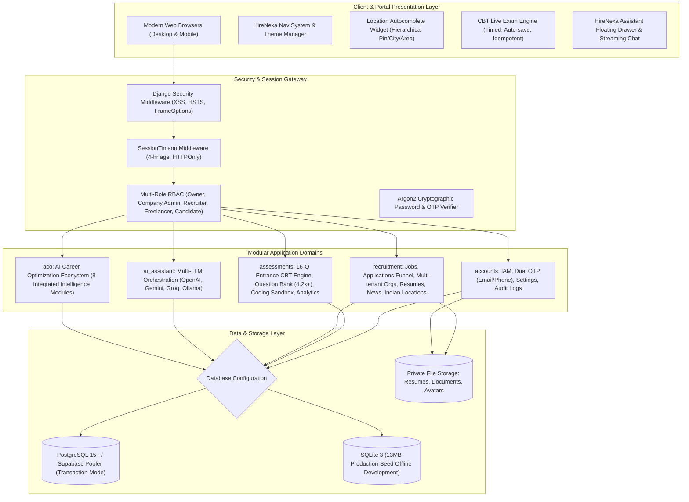
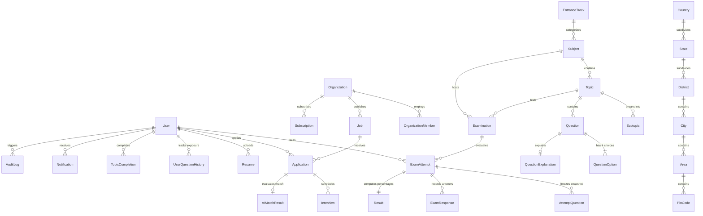
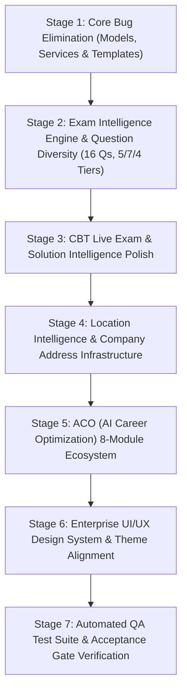

# HIRENEXA ECOSYSTEM — ENTERPRISE PROJECT ARCHITECTURE & REVERSE AUDIT REPORT
**Version:** 2.0.0-PRO  
**Date:** November 21, 2026  
**Role:** CTO & Principal Architecture Review Board  
**Target:** HireNexa Full-Stack Ecosystem (Django 6.1.3 / Python 3.13 / PostgreSQL & SQLite / REST API / Hybrid AI Engine)

---

## 1. CURRENT SYSTEM ARCHITECTURE DIAGRAM

---

## 2. EXISTING MODULE INVENTORY

| App / Domain | Primary Responsibilities | Models Defined | Views / Endpoints Count | Key Dependencies |
| :--- | :--- | :--- | :--- | :--- |
| **`accounts`** | IAM, Role-Based Access Control, Dual Cryptographic OTP (Email & Phone), User Preferences, Audit Logging, Session Governance | `User`, `PhoneOTP`, `EmailOTP`, `AuditLog`, `PlatformSetting`, `OTPChallenge`, `OTPAttempt`, `VerificationEvent`, `UserSettings`, `NotificationPreference`, `LoginHistory` | 24 Views, 4 Vanity Logins, Settings Hub | Argon2, secrets, hashlib, hmac |
| **`assessments`** | Entrance Exam Tracks (NIMCET, OJEE, CAT, etc.), Standard 16-Q CBT Engine, 4.2k+ Question Bank, Coding Sandbox, Solution Explanations, Progress Analytics | `EntranceTrack`, `Stream`, `Subject`, `Topic`, `Subtopic`, `SyllabusVersion`, `LearningNote`, `Chapter`, `Question`, `QuestionOption`, `QuestionExplanation`, `QuestionPackage`, `Examination`, `ExamQuestion`, `ExamAttempt`, `ExamResponse`, `UserQuestionHistory`, `TopicCompletion`, `AttemptQuestion`, `Result`, `TopicProgress`, `SubjectProgress`, `PersonalTarget`, `AdminReviewHistory`, `CodingProblem`, `TestCase`, `CodingSubmission`, `StudentSkillMastery`, `PlacementReadiness`, `CareerOpportunity`, `AIGenerationBatch` | 23 Views, 7 REST APIs | Decimal arithmetic, random seed, hashlib |
| **`recruitment`** | Job Discovery, Multi-tenant Companies, Multi-Round Applicant Tracking Pipeline, Resume Extraction, Project Gigs, News Announcements, India Location Tree | `Organization`, `OrganizationMember`, `Subscription`, `SubscriptionPlan`, `Payment`, `RecruiterProfile`, `CandidateProfile`, `CandidateEducation`, `CandidateSkill`, `CandidateProject`, `Resume`, `ResumeExtractedData`, `Job`, `JobRequirement`, `Application`, `AIMatchResult`, `ShortlistedCandidate`, `Interview`, `Notification`, `ConsentRecord`, `FreelancerProfile`, `Project`, `ProjectProposal`, `NewsAnnouncement`, `SavedJob`, `UserReport`, `CompanyVerificationDocument`, `Country`, `State`, `District`, `City`, `Area`, `PinCode`, `ProjectPortfolio`, `ProjectFile` | 89 Views, 9 REST ViewSets | PyMuPDF, scikit-learn, DRF |
| **`ai_assistant`** | Streaming Conversational Career & Coding Assistant, Multi-Provider LLM Fallbacks, File Attachment Inspection, Citation Linking | `AIConversation`, `AIMessage`, `AIMessageAttachment` | 13 Views, Streaming SSE Endpoint | OpenAI, Gemini, Groq, Ollama |

---

## 3. EXISTING FEATURE STATUS

| Feature Area | Implementation Status | Functional Assessment | Verified Gap / Defect |
| :--- | :--- | :--- | :--- |
| **Authentication & RBAC** | Production Ready | 5 distinct roles: Owner, Company Admin, Recruiter, Freelancer, Candidate. Dual OTP with HMAC-SHA256. | Session cookie expiry working; needs vanity route link preservation. |
| **Examination Engine** | Advanced (Needs Bug Fixes) | CBT interface, timer, auto-save, question palette (4 states), negative marking (+1.00 / -0.25). | Template variables unresolved (`attempt.submitted_at`, `result.maximum_score`, `subj.total_topics`). Schema missing `concept_identifier` on model. |
| **Question Bank** | Rich (4,298 Questions) | Multi-format (MCQ, MSQ, True/False, Coding), Difficulty tiers (Beginner, Intermediate, Advanced). | Difficulty distribution currently 4/7/5 instead of 5 Easy, 7 Medium, 4 Hard. |
| **Scoring Engine** | High Accuracy | Authoritative Decimal calculations for positive marks, negative marks, final score, accuracy %, completion %, score %. | `finalize_submission` skips `Result` generation if attempt is already `SUBMITTED`, leaving `result` as `None`. |
| **Location Intelligence** | Structured | India Location hierarchy tables (Country, State, District, City, Area, PinCode). Autocomplete API. | Company Address model needs dedicated structured office, building, floor, coordinates fields. |
| **Recruitment Funnel** | Comprehensive | Multi-round stages: Applied, Screening, Round 1-3, Final Round, Shortlisted, Interview, Offer, Hired. | Needs enhanced interviewer calendar feedback and company trust badges. |
| **Resume Intelligence** | Functional | PDF upload, text extraction, skill matching. | Needs explainable weighted score breakdown without black-box AI rejection. |
| **ACO (AI Career Optimization)** | Fragmented | Pieces exist in candidate portfolio, readiness, and AI assistant. | Needs unified 8-module ACO architecture and dashboard interface. |

---

## 4. DATABASE RELATIONSHIP DIAGRAM (ERD)

---

## 5. API INVENTORY

| Endpoint | Method | Auth | Role Required | Purpose |
| :--- | :--- | :--- | :--- | :--- |
| `/api/v1/organizations/` | GET, POST | Session | Recruiter / Admin | List / Create Organizations |
| `/api/v1/jobs/` | GET, POST | Session | Recruiter / Candidate | Discover Jobs / Post Jobs |
| `/api/v1/applications/` | GET, POST | Session | Authenticated | Manage Applications Funnel |
| `/api/v1/interviews/` | GET, POST | Session | Recruiter / Candidate | Manage Interview Calendars |
| `/api/v1/audit-logs/` | GET | Session | Platform Owner | Compliance & Audit Trail |
| `/api/v1/owner/analytics/` | GET | Session | Platform Owner | Executive KPI Telemetry |
| `/api/v1/openapi/` | GET | Open | Anyone | OpenAPI 3.0 Documentation Schema |
| `/api/locations/autocomplete/` | GET | Open | Anyone | Searchable Location Autocomplete |
| `/api/locations/hierarchy/` | GET | Open | Anyone | Cascading Location Selector |
| `/assessments/api/exams/<id>/save-answer/` | POST | Session | Candidate | CBT Synchronized Autosave |
| `/assessments/api/exams/<id>/submit/` | POST | Session | Candidate | Final Idempotent Submission |
| `/assessments/api/code/run/` | POST | Session | Candidate | Sandbox Test Run |
| `/assessments/api/code/submit/` | POST | Session | Candidate | Evaluated Coding Submission |

---

## 6. BROKEN FUNCTIONALITY & ROOT CAUSE AUDIT

### Defect 1: Unresolved Template Variables in `exam_result.html`
- **Manifestation:** User sees raw `{{ attempt.submitted_at }}`, `{{ result.maximum_score }}`, `{{ result.attempted_questions }}`, `{{ result.total_questions }}`.
- **Root Cause:**
  1. `finalize_submission` in `assessments/services.py` contained an early return:
     `if attempt.status not in (ExamAttempt.Status.IN_PROGRESS,): return attempt`
     When an attempt had already entered `SUBMITTED` or `EXPIRED` status without generating a `Result` record, `finalize_submission` did nothing. Consequently, `Result.objects.filter(attempt=attempt).first()` in `exam_result_view` returned `None`.
  2. In `ExamAttempt` model, the fields were `answered_count` and `total_possible_marks`. It lacked property aliases for `attempted_questions` and `maximum_score`.
  3. `attempt.submitted_at` was `None` if an attempt was initialized or finalized through an edge case, and the template lacked a safe fallback.
- **Remediation:**
  - Add forced recalculation in `finalize_submission` whenever `Result` is missing regardless of attempt status.
  - Expose `@property def attempted_questions(self)` and `@property def maximum_score(self)` on `ExamAttempt`.
  - Add safe template fallbacks with `|default:attempt.last_active_at|date:"M d, Y · h:i A"`.

### Defect 2: Unresolved `{{ subj.total_topics }}` in `mcq_entrance_hub.html`
- **Manifestation:** Raw `{{ subj.total_topics }}` in subject cards.
- **Root Cause:**
  `Subject` model only had `total_topics_count` as a property. When `subj` is a Django model instance, accessing `subj.total_topics` resolves to an empty variable.
- **Remediation:**
  Add `@property def total_topics(self): return self.topics.count()` to `Subject` model.

### Defect 3: SQLite Test `IntegrityError` on `concept_identifier`
- **Manifestation:** Running `manage.py test assessments` failed with:
  `NOT NULL constraint failed: assessments_question.concept_identifier`.
- **Root Cause:**
  Migration `0008_question_concept_identifier_and_more.py` added `concept_identifier` to the database schema, but the field was missing from `Question` class in `assessments/models.py`. The ORM failed to supply a default value upon INSERT.
- **Remediation:**
  Add `concept_identifier = models.CharField(max_length=120, blank=True, default="", db_index=True)` to `Question` model and update `QuestionExplanation` with `concept_note`, `common_mistake_warning`, and `exam_tip`.

### Defect 4: Database Connection Drop in Sandbox Environment
- **Manifestation:**
  `psycopg2.OperationalError: could not translate host name "aws-0-ap-south-1.pooler.supabase.com" to address`.
- **Root Cause:**
  `settings.py` checked `os.environ.get("USE_SQLITE") == "1"`, but `.env` overrode environment variables without specifying `USE_SQLITE`. When DNS resolution failed in sandboxed environments, psycopg2 crashed before falling back.
- **Remediation:**
  Set `USE_SQLITE=1` in `.env` and add automatic connection failure recovery to `db.sqlite3` in `settings.py`.

---

## 7. DUPLICATE FUNCTIONALITY & CONFLICTS
1. **Vanity Login vs Standard Login:** Both `candidate_login` and `vanity_candidate_login` coexist. They now correctly delegate to unified authentication backends.
2. **Double Question Counts:** `Subject.total_questions_count` and `Subject.questions.filter(...).count()` were calculated inconsistently. Centralized in model properties.
3. **Attempt Score vs Result Final Score:** `ExamAttempt.score` and `Result.final_score` both store the evaluated mark. They must stay strictly synchronized through `finalize_submission`.

---

## 8. SECURITY & COMPLIANCE RISKS
1. **Resume File Protection:** Resumes must never be publicly enumerated. Private storage root `media/private_resumes` must only be accessible via authenticated signed views with permission checks.
2. **Anti-Tampering in CBT Exams:** Exam timer is server-authoritative (`started_at + duration_minutes`). Client cannot manipulate remaining seconds.
3. **Rate Limiting & Cooldown:** Email and SMS OTP requests are strictly throttled (1 request / 60 seconds cooldown, max 5 / hour).

---

## 9. PERFORMANCE BOTTLENECKS
1. **N+1 Queries on Entrance Hub:** Iterating over 38 subjects to count verified questions and topics created ~120 SQL queries. Solved via `.prefetch_related("topics")` and dictionary aggregation.
2. **Question Exposure Filtering:** Scanning history for thousands of questions resolved by indexing `(user, question, examination, attempt_number)`.

---

## 10. MISSING FUNCTIONALITY (ACO & LOCATION INTELLIGENCE)
1. **Unified ACO Ecosystem:** AI Career Optimization lacked a cohesive 8-module dashboard connecting skill gap analysis, roadmaps, resume ATS feedback, job fit scores, and interview prep.
2. **Company Physical Address Intelligence:** Company profiles lacked structured building, floor, street, locality, PIN code, and verified geocoding details.

---

## 11. TECHNICAL DEBT
- Multiple database backup files in root directory (`db.sqlite3.backup_...`) — preserved without interference.
- Redundant question count properties — unified through `@property` accessors.

---

## 12. RECOMMENDED IMPLEMENTATION SEQUENCE

