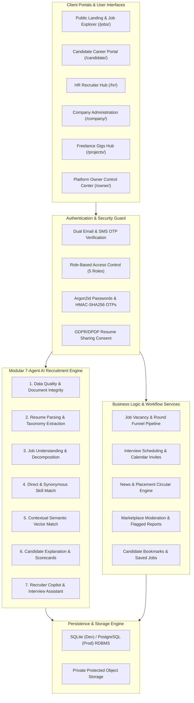

# HireNexa – AI Recruitment, Job Marketplace & Career Intelligence Platform

[](https://www.python.org/)
[](https://www.djangoproject.com/)
[]()
[]()
[]()

**HireNexa** is an enterprise-grade AI-powered recruitment, job marketplace, and talent intelligence SaaS platform. The system connects **Job Seekers / Candidates**, **Hiring Companies & Recruiters**, **Freelance Contractors**, and **Platform Administrators** through 100% explainable skill matching, cryptographic dual-channel authentication, vacancy lifecycle tracking, and campus placement hubs.

---

## 🏛️ Platform Architecture Overview



---

## 🚀 Key Feature Matrix by User Role

### 1. Job Seekers & Placement Candidates (`/candidate/`)
- **Dual OTP Registration**: Validated name, email, country code (`+91`), mobile number, and password.
- **Career Dashboard**: Real-time progress, profile completeness meter, and notifications.
- **My Resumes**: Upload PDF/DOCX (max 5MB), secure inline browser preview, download, and delete.
- **AI Resume Diagnostics (`/resume-analyzer/`)**: 100% explainable score, matched skills, skill gaps, and learning tips.
- **Recommended Jobs (`/jobs/recommended/`)**: Personalized AI matches based on verified competencies and academic stream.
- **Saved Jobs (`/jobs/saved/`)**: One-click bookmarking of open positions while browsing.
- **Application Tracking**: Live status stages (`Applied`, `Screening`, `1st Round`, `2nd Round`, `3rd Round`, `Final HR`, `Hired`, `Rejected`, `Withdrawn`) with voluntary application withdrawal.
- **Consent Center**: Explicit GDPR/DPDP consent toggle for employer resume sharing.

### 2. Hiring Companies, Recruiters & HR Managers (`/company/`, `/hr/`)
- **Company Verification (`/company/verification-upload/`)**: Upload Certificate of Incorporation, GSTIN, PAN card, or business license for verified employer status.
- **Multi-Tenant Team Seats**: Company admins can provision recruiter accounts with scoped department roles.
- **Job Requisitions**: Post vacancies with department streams (`MCA`, `MBA`, `B.Tech`), hiring targets, round funnels, and compensation ranges.
- **Headcount Funnel Management**: Real-time round progression (`1st Round` to `Hired`) with vacancy quota adjustment.
- **Applicant Screening & AI Scorecards**: Rank candidates by skill overlap and semantic match without automated black-box rejections.
- **Interview Management**: Schedule, reschedule, or cancel interviews (Online Video Call, Phone, In-person) with automatic applicant notification.

### 3. Freelancing Marketplace (`/projects/`)
- **Clients**: Post fixed-price or hourly projects with budget constraints and required technical deliverables.
- **Freelancers (`/freelancer/`)**: Create contractor profiles, manage portfolios, submit quotes/bids, and track proposals.
- **Safety**: Built-in reporting mechanism (`/report/`) to flag suspicious listings for platform moderation.

### 4. Platform Administrators (`/owner/`)
- **Master Telemetry**: Real-time metrics for registered candidates, recruiters, verified companies, vacancies, and MRR.
- **Company Verification Queue**: One-click document review, approval, and documented rejection reasons.
- **Moderation Queue**: Review, resolve, or dismiss flagged user reports.
- **Broadcast System**: Publish platform-wide circulars and placement drive announcements.
- **Audit Trails**: Full cryptographic event logging of logins, resume downloads, status changes, and administrative actions.

---

## 🛠️ Technology Stack

| Layer | Technologies |
| :--- | :--- |
| **Backend Framework** | Python 3.13, Django 6.1, Django REST Framework |
| **Database** | SQLite (Development) / PostgreSQL 16 (Production) |
| **Document Processing** | PyMuPDF (`fitz`), `python-docx` |
| **Machine Learning / AI** | Sentence-Transformers (`all-MiniLM-L6-v2`), Scikit-Learn, NumPy |
| **Authentication & Security** | Argon2id Password Hasher, HMAC-SHA256 OTP Hash, Google `phonenumbers` |
| **Delivery Integrations** | Resend API, Amazon SES, SendGrid, Twilio SMS, MSG91 DLT Gateway |

---

## 🌐 Complete Portal & Route Sitemap

| Page / Endpoint | URL | Accessibility |
| :--- | :--- | :--- |
| **Homepage** | [`/`](http://127.0.0.1:8000/) | Public |
| **Find Jobs (MCA/MBA/Eng)** | [`/jobs/`](http://127.0.0.1:8000/jobs/) | Public |
| **Hiring Companies Directory** | [`/companies/`](http://127.0.0.1:8000/companies/) | Public |
| **AI Resume Analyzer** | [`/resume-analyzer/`](http://127.0.0.1:8000/resume-analyzer/) | Public / Candidates |
| **Career Resources & Prep** | [`/resources/`](http://127.0.0.1:8000/resources/) | Public |
| **Freelance Gigs Hub** | [`/projects/`](http://127.0.0.1:8000/projects/) | Public |
| **News & Placement Circulars** | [`/news/`](http://127.0.0.1:8000/news/) | Public |
| **Unified Sign In** | [`/accounts/login/`](http://127.0.0.1:8000/accounts/login/) | Public |
| **Multi-Role Registration** | [`/accounts/signup/`](http://127.0.0.1:8000/accounts/signup/) | Public |
| **Dual OTP Verification** | [`/accounts/verify/`](http://127.0.0.1:8000/accounts/verify/) | Pending Verification |
| **Candidate Dashboard** | [`/candidate/`](http://127.0.0.1:8000/candidate/) | Candidates |
| **Saved Jobs Bookmarks** | [`/jobs/saved/`](http://127.0.0.1:8000/jobs/saved/) | Candidates |
| **AI Recommended Jobs** | [`/jobs/recommended/`](http://127.0.0.1:8000/jobs/recommended/) | Candidates |
| **In-App Notifications** | [`/notifications/`](http://127.0.0.1:8000/notifications/) | Authenticated Users |
| **HR Recruiter Workspace** | [`/hr/`](http://127.0.0.1:8000/hr/) | HR / Recruiters |
| **Company Administration** | [`/company/`](http://127.0.0.1:8000/company/) | Company Admins |
| **Company Verification Upload**| [`/company/verification-upload/`](http://127.0.0.1:8000/company/verification-upload/) | Company Admins |
| **Freelancer Contractor Hub** | [`/freelancer/`](http://127.0.0.1:8000/freelancer/) | Freelancers |
| **Platform Owner Control** | [`/owner/`](http://127.0.0.1:8000/owner/) | Platform Owner |
| **Django Admin Console** | [`/admin/`](http://127.0.0.1:8000/admin/) | Staff / Superuser |
| **REST API v1** | [`/api/v1/`](http://127.0.0.1:8000/api/v1/) | Token / Session Authenticated |
| **Terms of Service** | [`/terms/`](http://127.0.0.1:8000/terms/) | Public |
| **Privacy Policy** | [`/privacy/`](http://127.0.0.1:8000/privacy/) | Public |

---

## 🧪 Automated Testing & Verification

The test suite validates multi-role access control, OTP security, AI skill extraction, semantic matching, application workflows, and moderation:

```powershell
Set-Location HireNexa_Advanced
python manage.py test
```

### Test Suite Execution Output
```
Ran 65 tests in 71.859s

OK
Destroying test database for alias 'default'...
Found 65 test(s).
System check identified no issues (0 silenced).
```
- **Total Tests:** 65
- **Passed:** 65
- **Failed / Errors:** 0

---

## 💻 Local Installation & Setup

1. **Clone & Navigate:**
   ```powershell
   git clone <repo_url>
   cd HireNexa_Advanced
   ```

2. **Set up Virtual Environment:**
   ```powershell
   python -m venv venv
   .\venv\Scripts\Activate.ps1
   ```

3. **Install Dependencies:**
   ```powershell
   pip install --upgrade pip
   pip install -r requirements.txt
   ```

4. **Run Database Migrations:**
   ```powershell
   python manage.py migrate
   ```

5. **Start Development Server:**
   ```powershell
   python manage.py runserver 127.0.0.1:8000
   ```
   Open **[http://127.0.0.1:8000/](http://127.0.0.1:8000/)** in your browser.

---

## 🔒 Security & Compliance Safeguards

- **Argon2id Hashing:** High-memory password derivation protects against GPU cracking attacks.
- **Zero OTP Exposure:** Verification codes are generated via `secrets.SystemRandom()`, hashed using `HMAC-SHA256`, and never printed in logs, HTML, or JSON response bodies.
- **Private Storage:** Resumes are saved outside the public static directory (`media/private_resumes/`) and require authenticated role clearance.
- **GDPR / DPDP Compliance:** Candidates can revoke resume-sharing consent at any time or execute the account and data purge workflow.
- **Audit Logging:** Security events (`LOGIN_SUCCESS`, `RESUME_DOWNLOADED`, `APPLICATION_WITHDRAWN`, `REPORT_RESOLVED`) are permanently logged with client IP addresses and user agent strings.
