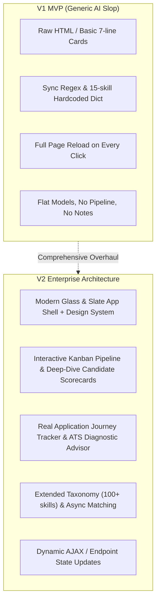
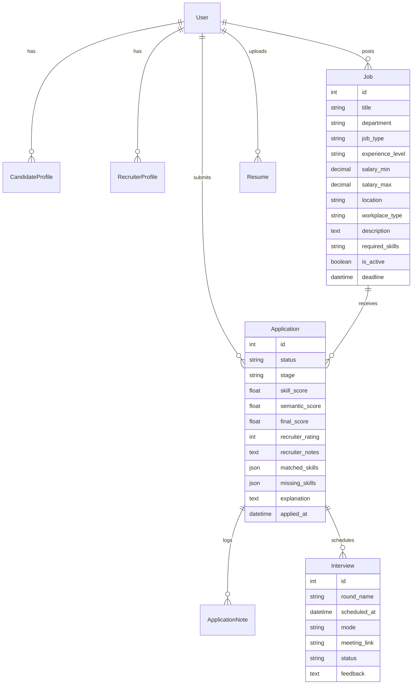

# HireNexa V2: Enterprise Recruitment & Talent Intelligence Platform
## Architectural Blueprint & Version 2 Execution Roadmap

---

## 1. Executive Summary & Engineering Philosophy

HireNexa V1 established a working proof-of-concept for role-based accounts, resume text extraction, and basic skill matching. However, in its current state, the user interface and interactions reflect classic **"AI slop"**—minimal boilerplate markup, rudimentary tables, raw `{{ form.as_p }}` forms, 7-line template files, a 15-word hardcoded skill dictionary, and superficial dashboards that lack real-world recruitment workflows.

Modern software engineering demands that recruitment platforms match the standards of Tier-1 SaaS applications (such as **Linear, Ashby, Greenhouse, and Stripe**):
* **No Dummy Elements**: Every metric, badge, tab, filter, and action must be bound to real database state and functional endpoints.
* **Fluid App Shell**: Responsive sidebar navigation, breadcrumbs, status indicators, quick-action command triggers, and zero-stutter AJAX/HTMX transitions.
* **Explainable Talent Intelligence**: Beyond flat percentages, recruiters need interactive candidate scorecards, skill gap breakdowns, recruiter notes, and end-to-end pipeline management (Kanban & List views).
* **High-Agency Candidate Experience**: Candidates must not only see application status, but also receive actionable ATS resume diagnostics, interview timelines, and profile readiness audits.



---

## 2. Forensic Audit of V1: The "AI Slop" Diagnosis

### 2.1 UI/UX & Design Deficits
1. **Shallow Template Architecture**:
   - `recruiter_dashboard.html` is only **7 lines** of unformatted HTML.
   - `candidate_dashboard.html` is **9 lines** with zero visual hierarchy.
   - Forms are rendered using Django's raw `{{ form.as_p }}`, producing unstyled `<p>` tags and default browser widgets.
2. **Absence of a Cohesive Design System**:
   - A single monolithic CSS file (`style.css`) with basic colors (`#3478f6` and `#101d3a`).
   - No design tokens for spacing, elevation, typography scales, or semantic alert states (success, warning, error, info).
   - No micro-interactions, hover states, loading skeletons, modal overlays, or responsive mobile navigation drawers.
3. **Static Page Reload Friction**:
   - Changing an applicant's status reloads the entire page, causing scroll-position loss and poor UX.

### 2.2 Functional & Domain Deficits
1. **Rudimentary Recruitment Pipeline**:
   - Applications have only 4 flat status choices (`PENDING`, `SHORTLISTED`, `REJECTED`, `INTERVIEW`).
   - Real-world hiring requires a true stage progression: `Applied` $\rightarrow$ `Screening` $\rightarrow$ `Technical Assessment` $\rightarrow$ `Interview` $\rightarrow$ `Offer` $\rightarrow$ `Hired` / `Archived`.
   - No ability for recruiters to record **internal candidate ratings** (1-5 stars), add **interviewer notes**, or specify **rejection reasons**.
2. **Crude Matching Engine**:
   - Only 15 hardcoded skill keys in `services.py` (`python`, `django`, `flask`, `fastapi`, `sql`, `javascript`, `html`, `css`, `react`, `java`, `c++`, `machine learning`, `nlp`, `git`, `aws`).
   - Missing modern industry standards (TypeScript, Next.js, Docker, Kubernetes, PostgreSQL, Redis, Tailwind, GraphQL, CI/CD, Agile, etc.).
   - Synchronous execution blocks web worker threads if semantic embedding calculation is triggered.
3. **Candidate Experience Gaps**:
   - Candidates receive zero guidance on *why* their score was low or *how* to improve their resume for a given job.
   - No previewer to inspect their uploaded resume without downloading a binary file.
   - No calendar integration or countdown for scheduled interviews.

---

## 3. Version 2 System Architecture & Design System

### 3.1 Design Language & Tokens ("Slate & Indigo" Palette)
* **Canvas & Surface**: Neutral slate backgrounds (`#0B0F17` dark / `#F8FAFC` light) with high-clarity contrast.
* **Primary Accent**: Electric Indigo (`#4F46E5` / `#6366F1`) paired with subtle violet highlights.
* **Functional Semantics**:
  - Success/Hired: Emerald (`#10B981` / `#059669`)
  - Warning/Under Review: Amber (`#F59E0B` / `#D97706`)
  - Danger/Rejected: Rose (`#F43F5E` / `#E11D48`)
  - Info/Interview: Cyan/Sky (`#0284C7` / `#0EA5E9`)
* **Typography**: Clean geometric typography using `Inter` system stack with tight tracking on headings (`-0.03em`) and tabular figures for analytics.
* **Component Primitives**:
  - Glassmorphic card surfaces with subtle 1px border (`rgba(226, 232, 240, 0.8)` or dark equivalent).
  - Floating status pills with dot indicators.
  - Interactive SVG icon set (Lucide-inspired clean vectors).
  - Tabbed sub-navigation and segmented controls.

### 3.2 Dual-Workspace Navigation Shell
```
+-----------------------------------------------------------------------------------------+
| [LOGO] HireNexa               [Search Jobs / Applicants (Ctrl+K)]     [🔔 3]  [User Avatar] |
+------------------+----------------------------------------------------------------------+
| SIDEBAR          | MAIN WORKSPACE CONTENT AREA                                          |
|                  |                                                                      |
| > Overview       | Breadcrumbs: Workspace > Active Jobs > Senior Backend Engineer       |
| > Pipeline Board |                                                                      |
| > Applicants (24)| [Stage Filter: All | Screening | Interview | Offer]   [Sort: Fit Score ▼]|
| > Job Openings   |                                                                      |
| > Schedule (4)   | +------------------------------------------------------------------+ |
| > Talent Pool    | | CANDIDATE CARD / PIPELINE COLUMN                                 | |
|                  | | John Doe · 94% Match · Python, Django, AWS, Docker               | |
| > Settings       | | [Quick Shortlist] [Schedule Interview] [View Full Dossier]       | |
|                  | +------------------------------------------------------------------+ |
+------------------+----------------------------------------------------------------------+
```

---

## 4. Recruiter Dashboard V2: Enterprise Talent Hub

### 4.1 Interactive Candidate Pipeline (Kanban & List Modes)
* **Kanban Columns**:
  1. **New Applications** (Incoming unreviewed applicants with instant match badge).
  2. **Screening & Review** (Recruiter reviewing profile and parsed resume).
  3. **Technical / Interview** (Scheduled interviews with datetime countdown and meet links).
  4. **Offer & Hired** (Final stage candidates).
  5. **Archived / Rejected** (Disqualified with logged reasons).
* **Instant Action Drawer**: Clicking any candidate opens an **Applicant Dossier Drawer** without leaving the board:
  - **Live Resume Viewer**: Embedded text/PDF preview side-by-side with job requirements.
  - **Explainable Skill Radar**: Matched skills in green pills, missing skills in red dashed pills, semantic description alignment score.
  - **Recruiter Rating & Private Notes**: 1-5 star fit rating, internal recruiter comment log with timestamps.
  - **One-Click Interview Scheduler**: Select round type, date/time, meeting platform (Google Meet/Zoom), and auto-generate candidate notification.

### 4.2 Job Management & Talent Analytics
* **Rich Job Creator**:
  - Structured fields: Department, Employment Type (Full-time, Remote, Hybrid), Experience Level (Junior, Mid, Senior, Lead), Salary Range (Min-Max + Currency), Application Deadline.
  - Tag-based skill input with auto-suggestions from taxonomy.
* **Live Recruitment Metrics**:
  - Total Active Openings, Total Candidates in Pipeline, Average Match Score, Time-to-Schedule Metric.

---

## 5. Candidate Dashboard V2: Career Acceleration Portal

### 5.1 Real Application Journey Tracker
* **Visual Progress Stepper**:
  - `Application Submitted` $\rightarrow$ `Resume Parsed & Screened` $\rightarrow$ `HR Review` $\rightarrow$ `Interview Scheduled` $\rightarrow$ `Decision`.
  - Timestamped activity log for every application.

### 5.2 ATS Resume Diagnostic & Optimization Engine
* **Match Breakdown**: Shows the candidate *exactly* how their resume performed against the job criteria:
  - Strong Matches: Verified skills found in resume.
  - Skill Gaps: Missing keywords required by the employer.
  - Actionable Advice: "Adding experience with Docker and PostgreSQL will increase your match score by 25% for this position."

### 5.3 Interview Center & Schedule Hub
* **Active Interview Card**:
  - Next upcoming interview badge with countdown timer.
  - One-click launch button for Google Meet / Zoom link.
  - Preparation checklist and job description refresher.

### 5.4 Profile Health & Completeness Gauge
* **Dynamic Health Ring (0–100%)**:
  - Calculates profile completeness based on uploaded resume, bio, education history, portfolio/GitHub link, and verified skills.

---

## 6. Data Model & Architecture Upgrades



---

## 7. Version 2 Phased Implementation Plan

| Phase | Focus Area | Key Deliverables | Verification Milestone |
| :--- | :--- | :--- | :--- |
| **Phase 1** | **Data Models & Database Layer** | Expand `Job`, `Application`, `Interview`, `CandidateProfile` with rich enterprise fields; generate migrations; seed realistic demo data. | All models support salary, stages, notes, and ratings without schema errors. |
| **Phase 2** | **Design System & Shell Architecture** | Modern CSS architecture (design tokens, glass cards, sidebar navigation, topbar with breadcrumbs, responsive drawer). | Global layout renders seamlessly across desktop and mobile viewports. |
| **Phase 3** | **Recruiter Workspace 2.0** | Interactive Pipeline (Kanban & List views), Applicant Dossier modal with resume text preview, in-line status updates, rating & notes. | Recruiter can drag/update candidate stages, record notes, and view scores without full page reload. |
| **Phase 4** | **Candidate Workspace 2.0** | Journey Tracker (visual stepper), ATS Diagnostic tool, profile strength gauge, interview countdown card. | Candidate views realistic timeline, skill gap analysis, and upcoming interview links. |
| **Phase 5** | **Talent Intelligence Engine 2.0** | Expanded 100+ skill taxonomy (frontend, backend, cloud, data, DevOps), fuzzy synonym matching, explainable recommendation text. | Matching engine correctly identifies modern tech stacks and generates rich explanations. |
| **Phase 6** | **Quality Assurance & Polish** | End-to-end integration tests, empty state illustrations, toast alerts, accessibility (WCAG AA), and performance validation. | Zero broken links, zero dummy placeholders, full end-to-end recruiter $\rightarrow$ candidate workflow tested. |

---

## 8. Immediate Next Actions & Review Decision

Before executing the coding phase, we will confirm the primary execution strategy:
1. **Full-Stack Django + Modern Glass CSS + Alpine/Vanilla Micro-Interactions**: Zero external heavy Node runtime dependencies, maximum speed and reliability, 100% native Django templates with modern responsive design tokens.
2. **Database Migration Strategy**: Backwards-compatible migrations on `accounts` and `recruitment` ensuring existing SQLite database is preserved or cleanly upgraded.
3. **Seed Data**: Create realistic, high-quality demonstration jobs, candidate resumes, and active applications across multiple stages so the dashboard immediately shines upon first launch.
